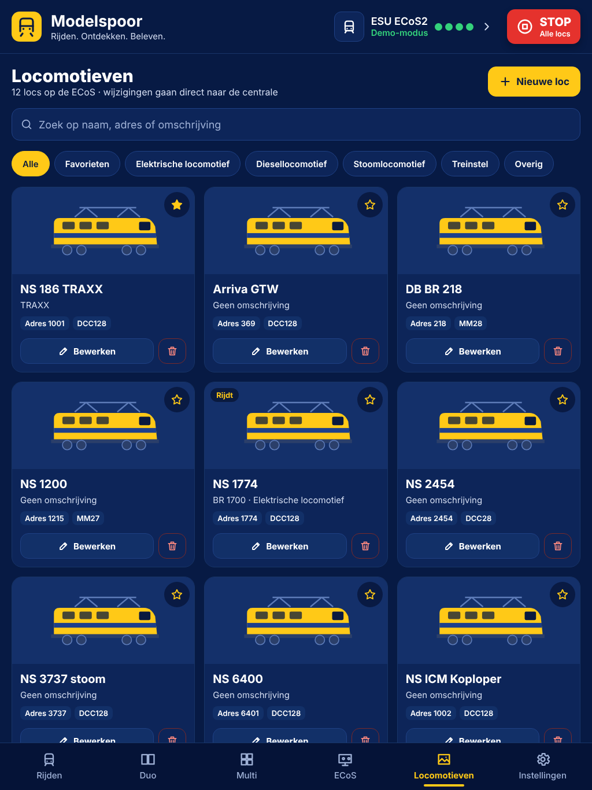
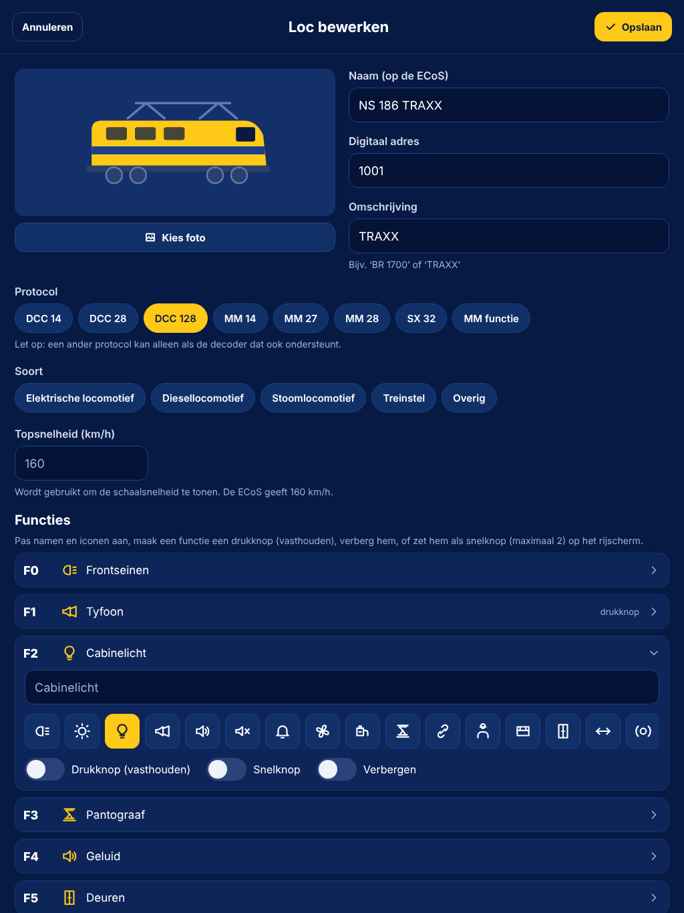

# ECoS Driver

iPad-app (React Native / Expo) om je modeltreinen te besturen via een **ESU ECoS** (50200/50210) in je eigen netwerk.

## Wat kan de app

- **Verbinden** met de ECoS via wifi (TCP-poort 15471), met automatisch opnieuw verbinden.
- **Rijden**: grote snelheidsknop met km/h, Vooruit/Neutraal/Achteruit, rem, noodstop en alle functies F0–F31 per loc. Drukknoppen (zoals de tyfoon) werken zolang je ze vasthoudt.
- **Duo**: twee locs naast elkaar besturen.
- **Multi**: tien locs tegelijk, in twee rijen van vijf.
- **ECoS**: een nagebouwd ECoS-bedienpaneel met twee draaiknoppen, STOP/GO en een aanraakscherm voor locs, functies en wissels. Het werkt met live gegevens uit je centrale. De ECoS zelf kan zijn scherm niet over het netwerk delen, daarom bouwt de app het na.
- **Locomotieven**: een bibliotheek waarin je locs **toevoegt, aanpast en verwijdert**. Naam, adres en protocol gaan direct naar de ECoS. Een foto, omschrijving, soort, topsnelheid en eigen functienamen en -iconen bewaart de app op de iPad.
- **Rijwegen en wissels** uit de ECoS schakelen.
- **Demo-modus**: een ingebouwde ECoS-simulator, zodat je alles zonder centrale kunt proberen.

## Op je iPad zetten

De app gebruikt een echte TCP-verbinding (`react-native-tcp-socket`). Dat werkt niet in Expo Go, dus je hebt een eigen build nodig.

**Met een Mac (Xcode):**

```bash
npm install
npx expo run:ios --device   # kies je iPad (via kabel of hetzelfde netwerk)
```

**Zonder Mac (EAS, in de cloud):**

```bash
npm install
npx eas-cli@latest build --profile development --platform ios
```

Na de installatie start je de ontwikkelserver met `npm start` en open je de app op de iPad.

Vraagt iOS bij de eerste keer om toegang tot het **lokale netwerk**, kies dan *Sta toe*. Zonder die toestemming kan de app de ECoS niet bereiken.

## Verbinden

1. Zet de iPad op hetzelfde netwerk als de ECoS.
2. Zoek het IP-adres op de ECoS op onder *Setup › Netwerk*.
3. Vul het in bij **Instellingen** in de app (poort 15471) en tik op **Verbinden**.

## Testen zonder ECoS

```bash
npm test        # protocoltests: parser, client en simulator, ook via echte TCP
npm run sim     # start een nep-ECoS op poort 15471 op je computer
npm run web     # app in de browser (alleen de demo-modus werkt in een browser)
```

Met `npm run sim` vul je in de app het IP-adres van je computer in. Zo test je de echte TCP-verbinding vanaf de iPad.

## Opbouw

| Map | Inhoud |
| --- | --- |
| `src/ecos/protocol.ts` | parser voor het ECoS-tekstprotocol (`<REPLY …>`, `<EVENT …>`, `<END …>`) |
| `src/ecos/client.ts` | ECoS-client: locs, functies, wissels, aanmaken/wijzigen/verwijderen |
| `src/ecos/simulator.ts` | ECoS-simulator voor de demo-modus en de tests |
| `src/ecos/tcpTransport.ts` | TCP-verbinding op iOS en Android |
| `src/store/` | app-state (zustand) en acties; instellingen worden bewaard op de iPad |
| `src/app/` | schermen (Expo Router): Rijden, Duo, Multi, ECoS, Locomotieven, Instellingen |
| `src/components/` | knoppen, snelheidsknop, schuifregelaars, panelen |

## Goed om te weten

- De ECoS kent snelheid 0–127, waarbij 1 een noodstop is. De app gebruikt daarom stappen 0–126 en slaat 1 over.
- Zodra je een loc bedient, neemt de app de besturing over (`request(id, control, force)`). Een loc die je ook op de ECoS of een handregelaar bedient, kan dus "overgenomen" worden. De app meldt dat.
- Stroom, spanning en temperatuur van de baan geeft de ECoS niet door via het netwerk. Het statuspaneel toont daarom wat wel echt is: of er spanning op de baan staat, hoeveel locs rijden en de reactietijd van de verbinding.

## Schermafbeeldingen (demo-modus)

| Rijden | Duo | Multi (liggend) |
| --- | --- | --- |
|  |  |  |

| ECoS | Locomotieven | Loc bewerken |
| --- | --- | --- |
|  |  |  |
