# ECoS Driver

iPad-app (React Native / Expo) om je modeltreinen te besturen via een **ESU ECoS** (50200/50210) in je eigen netwerk.

## Wat kan de app

De app is ingericht als een Apple-app op de iPad: een zijbalk links (staand smal, liggend breed), grafiet-tinten, één amber accentkleur en rood alleen voor STOP.

- **Centrales**: profielen voor meerdere ECoS-centrales (bijv. thuisbaan en clubbaan) met IP-adres en poort; verbinden met één tik, of de **demo-modus** zonder centrale.
- **Overzicht**: tellers (locs, wissels, rijwegen, rijdende locs, reactietijd), de baanstatus met STOP/GO, recent bestuurde locs en snel schakelen van wissels en rijwegen.
- **Rijden**: eindeloos draaiwiel voor de snelheid: scroll omhoog (of naar rechts) voor meer gas, omlaag voor minder; bij vol vermogen geeft verder scrollen niets meer en terugdraaien neemt meteen gas terug. Tijdens het bedienen scrolt de pagina niet mee, Vooruit/Neutraal/Achteruit, rem, loc stoppen en alle functies F0–F31 als drukknoppen met icoontjes (amber = aan; met handje = alleen zolang je drukt).
- **Loc wisselen in elk rijscherm**: op Rijden met de strook recente locs bovenaan of de knop *Wissel loc*; in Duo, Multi en op het ECoS-scherm met een eigen *Wissel loc*-knop per regelaar. Het wisselvenster heeft zoeken en de filters Alle, Recent en Favorieten.
- **Duo**: twee locs naast elkaar. **Multi**: tien locs in twee rijen van vijf.
- **ECoS-scherm**: het **echte scherm van de ECoS live via VNC**: tik en sleep om te bedienen. VNC-poort (standaard 5900) en wachtwoord stel je per centrale in. Of kies *Nagebouwd*: een bedienpaneel met twee draaiwielen, STOP/GO en een aanraakscherm voor locs, functies en wissels.
- **Bibliotheek**: locs in een tabel (sorteren, zoeken, filteren), toevoegen, aanpassen en verwijderen op de ECoS; foto, omschrijving, soort, topsnelheid en eigen functienamen/-iconen bewaart de app op de iPad. Tweede tabblad: wissels en rijwegen.
- STOP/GO voor de hele baan staat altijd rechtsboven.
- **Licht en donker thema**: in Instellingen kies je Automatisch (volgt de iPad), Licht of Donker.

## Op je iPad zetten

De app gebruikt een echte TCP-verbinding (`react-native-tcp-socket`). Dat werkt niet in Expo Go, dus de app moet als eigen app gebouwd worden.

### Gratis, zonder Mac (aanbevolen)

GitHub bouwt de app gratis op een Mac in de cloud. Jij zet hem daarna met **Sideloadly** en je gewone, gratis Apple ID op de iPad.

**1. De app laten bouwen (.ipa)**

*Optie 1: Codemagic.* Werkt meteen en kost niets.

1. Maak een gratis account op [codemagic.io](https://codemagic.io) en log in met GitHub.
2. Kies **Add application** › GitHub › **Ecos-Driver**. Kies als type *codemagic.yaml* (dat bestand staat al in de repo).
3. Klik op **Start new build**, kies de branch `claude/ecos-driver-app` en de workflow **iPad-app (voor Sideloadly)**.
4. Na ongeveer 15 minuten download je bij *Artifacts* het bestand **ECoS-Driver.ipa**.

*Optie 2: GitHub Actions.* Dit werkt alleen als Actions op je GitHub-account draait. Start er niets, kijk dan op github.com › *Settings › Billing and plans*: daar staat waarom het geblokkeerd is. Bij een **openbare** repo is Actions altijd gratis.

1. Ga op github.com naar deze repo › **Actions** › **iPad-app bouwen**.
2. Open de laatste groene run (met vinkje). Wil je een nieuwe build? Tik op **Run workflow**. Na elke wijziging aan de app bouwt GitHub ook vanzelf.
3. Download onderaan bij *Artifacts* het bestand **ECoS-Driver-ipa** en pak de zip uit. Daarin zit `ECoS-Driver.ipa`.

**2. Op de iPad zetten met Sideloadly (Windows of Mac)**

1. Installeer [Sideloadly](https://sideloadly.io). Op Windows heb je ook **iTunes** en **iCloud** nodig, de versies van apple.com en niet uit de Microsoft Store.
2. Sluit de iPad met een kabel aan en tik op de iPad op *Vertrouw deze computer*.
3. Sleep `ECoS-Driver.ipa` in Sideloadly, vul je Apple ID in en klik op **Start**. Je kunt hiervoor ook een apart, gratis Apple ID maken.
4. Op de iPad: *Instellingen › Algemeen › VPN en apparaatbeheer* › je Apple ID › **Vertrouw**.
5. Zet op iPadOS 16 of nieuwer de **Ontwikkelaarsmodus** aan: *Instellingen › Privacy en beveiliging › Ontwikkelaarsmodus*. De iPad start daarna opnieuw op.

Met een gratis Apple ID werkt de app **7 dagen**. Daarna zet je hem op dezelfde manier opnieuw op de iPad. Je instellingen en locs blijven bewaard. In Sideloadly kun je ook automatisch vernieuwen aanzetten: dat gebeurt dan via wifi zolang je computer aan staat.

### Manier A: zonder Mac, met een betaald Apple-account (EAS)

Je hebt nodig: een computer (Windows, Mac of Linux) met [Node.js](https://nodejs.org) 20 of nieuwer, een gratis account op [expo.dev](https://expo.dev) en een betaald **Apple Developer**-account (€99 per jaar). Apple staat installeren op je eigen iPad via de cloud alleen toe met dat account.

```bash
git clone https://github.com/Luc-nbr/Ecos-Driver.git
cd Ecos-Driver
git checkout claude/ecos-driver-app
npm install
npx eas-cli@latest login                 # inloggen met je expo.dev-account
npx eas-cli@latest device:create         # je iPad aanmelden
npx eas-cli@latest build --profile preview --platform ios
```

1. `device:create` geeft een link of QR-code. Open die op de iPad in Safari en installeer het profiel (*Instellingen › Profiel gedownload*).
2. Bij `build` vraagt EAS om in te loggen met je Apple-account. Laat EAS de certificaten en profielen zelf regelen (antwoord steeds *Yes*).
3. Na ongeveer 15–20 minuten krijg je een link en QR-code. Open die op de iPad en tik op *Installeer*.
4. Zet op iPadOS 16 of nieuwer de **Ontwikkelaarsmodus** aan: *Instellingen › Privacy en beveiliging › Ontwikkelaarsmodus*. De iPad start daarna opnieuw op.

Het profiel `preview` maakt een losse app. Je computer hoeft daarna niet aan te staan.

### Manier B: met een Mac (Xcode, gratis Apple ID)

Installeer Xcode uit de App Store en sluit de iPad met een kabel aan. Vertrouw de Mac als de iPad daarom vraagt.

```bash
git clone https://github.com/Luc-nbr/Ecos-Driver.git
cd Ecos-Driver
git checkout claude/ecos-driver-app
npm install
npx expo run:ios --device --configuration Release
```

1. Kies je iPad in de lijst.
2. Lukt het ondertekenen niet, open dan `ios/ECoSDriver.xcworkspace` in Xcode. Kies bij *Signing & Capabilities › Team* je Apple ID en voer het commando opnieuw uit.
3. Vertrouw jezelf als ontwikkelaar op de iPad: *Instellingen › Algemeen › VPN en apparaatbeheer › [je Apple ID] › Vertrouw*.
4. Zet ook hier de **Ontwikkelaarsmodus** aan (zie manier A, stap 4).

Met een gratis Apple ID werkt de app 7 dagen. Daarna voer je het commando opnieuw uit. Met een betaald account werkt hij een jaar.

### Eerste keer openen

- Vraagt iOS om toegang tot het **lokale netwerk**, kies dan *Sta toe*. Zonder die toestemming kan de app de ECoS niet bereiken. Je kunt het later aanzetten via *Instellingen › Privacy en beveiliging › Lokaal netwerk*.
- Ga naar **Instellingen** in de app, vul het IP-adres van je ECoS in en tik op **Verbinden**. Of probeer eerst de **Demo-modus**.

## Verbinden

1. Zet de iPad op hetzelfde netwerk als de ECoS.
2. Zoek het IP-adres op de ECoS op onder *Setup › Netwerk*.
3. Vul het in bij **Instellingen** in de app (poort 15471) en tik op **Verbinden**.

## Testen zonder ECoS

```bash
npm test        # protocoltests (ECoS en VNC), ook via echte TCP
npm run sim     # start een nep-ECoS op poort 15471 en een nep-VNC-scherm op poort 5900
npm run web     # app in de browser (alleen de demo-modus werkt in een browser)
```

Met `npm run sim` vul je in de app het IP-adres van je computer in. Zo test je de echte TCP-verbinding vanaf de iPad.

## Opbouw

| Map | Inhoud |
| --- | --- |
| `src/ecos/protocol.ts` | parser voor het ECoS-tekstprotocol (`<REPLY …>`, `<EVENT …>`, `<END …>`) |
| `src/ecos/client.ts` | ECoS-client: locs, functies, wissels, aanmaken/wijzigen/verwijderen |
| `src/ecos/simulator.ts` | ECoS-simulator voor de demo-modus en de tests |
| `src/ecos/tcpTransport.ts` | TCP-verbinding op iOS en Android |
| `src/vnc/` | eigen VNC-client (RFB 3.3–3.8, wachtwoord via DES, Raw/CopyRect) en een nagebouwde VNC-server voor demo en tests |
| `src/store/` | app-state (zustand) en acties; instellingen worden bewaard op de iPad |
| `src/app/` | schermen (Expo Router): Centrales, Overzicht, Rijden, Duo, Multi, ECoS-scherm, Bibliotheek, Instellingen |
| `src/components/` | knoppen, snelheidsknop, schuifregelaars, panelen |
| `codemagic.yaml`, `.github/workflows/` | gratis bouwen van de iPad-app in de cloud |

## Goed om te weten

- De ECoS kent snelheid 0–127, waarbij 1 een noodstop is. De app gebruikt daarom stappen 0–126 en slaat 1 over.
- Zodra je een loc bedient, neemt de app de besturing over (`request(id, control, force)`). Een loc die je ook op de ECoS of een handregelaar bedient, kan dus "overgenomen" worden. De app meldt dat.
- VNC: de ECoS moet een VNC-server aanbieden (ECoS CAB gebruikt dit ook). Lukt verbinden niet, controleer dan op de ECoS of VNC aan staat en welke poort en welk wachtwoord hij gebruikt. Het beeld wordt een paar keer per seconde ververst; dat is genoeg om te bedienen, niet voor vloeiende animaties.
- Stroom, spanning en temperatuur van de baan geeft de ECoS niet door via het netwerk. Het statuspaneel toont daarom wat wel echt is: of er spanning op de baan staat, hoeveel locs rijden en de reactietijd van de verbinding.

## Schermafbeeldingen (demo-modus)

| Rijden | Loc wisselen | Overzicht |
| --- | --- | --- |
| 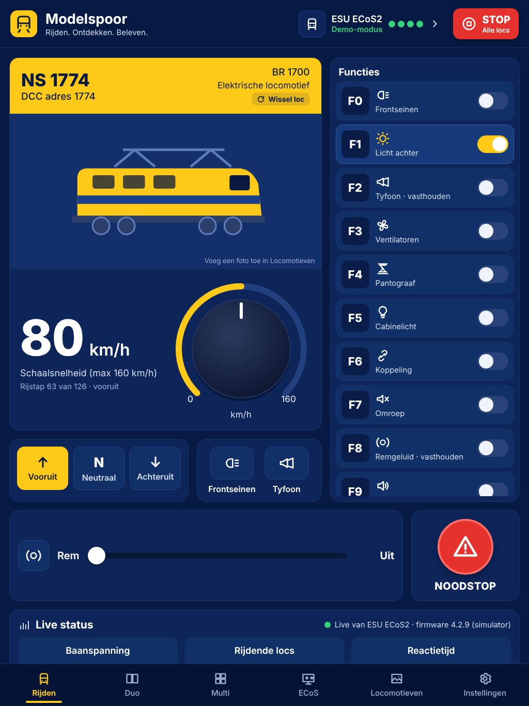 | 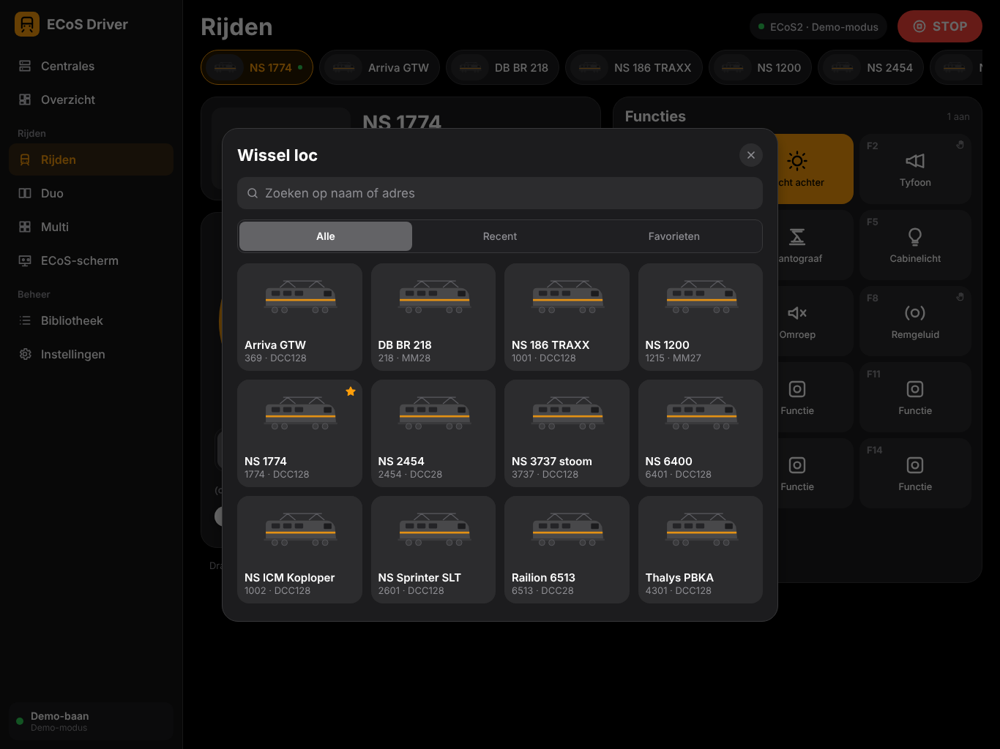 | 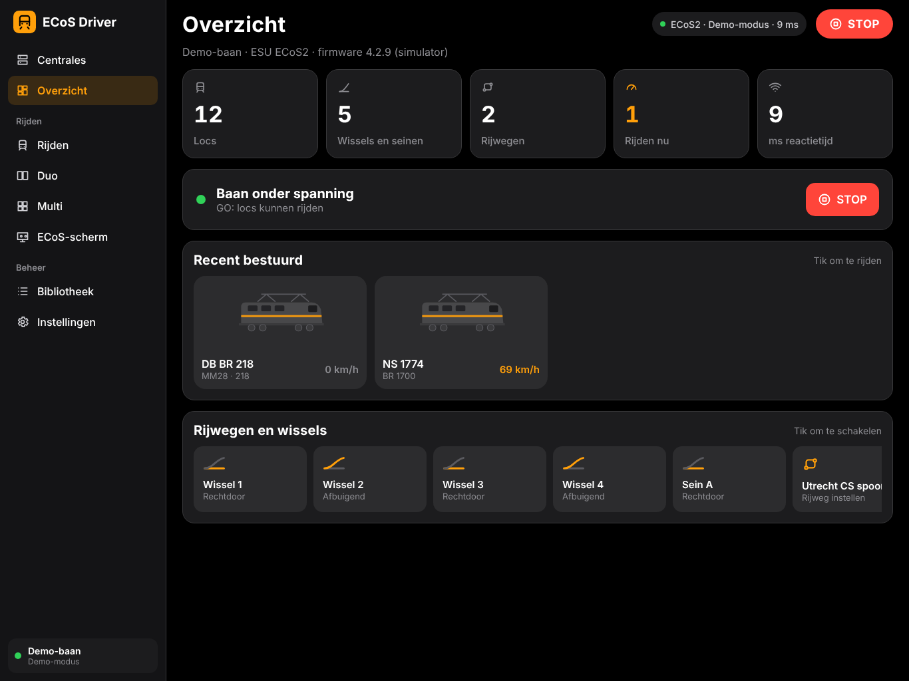 |

| Duo | Multi | ECoS-scherm |
| --- | --- | --- |
| 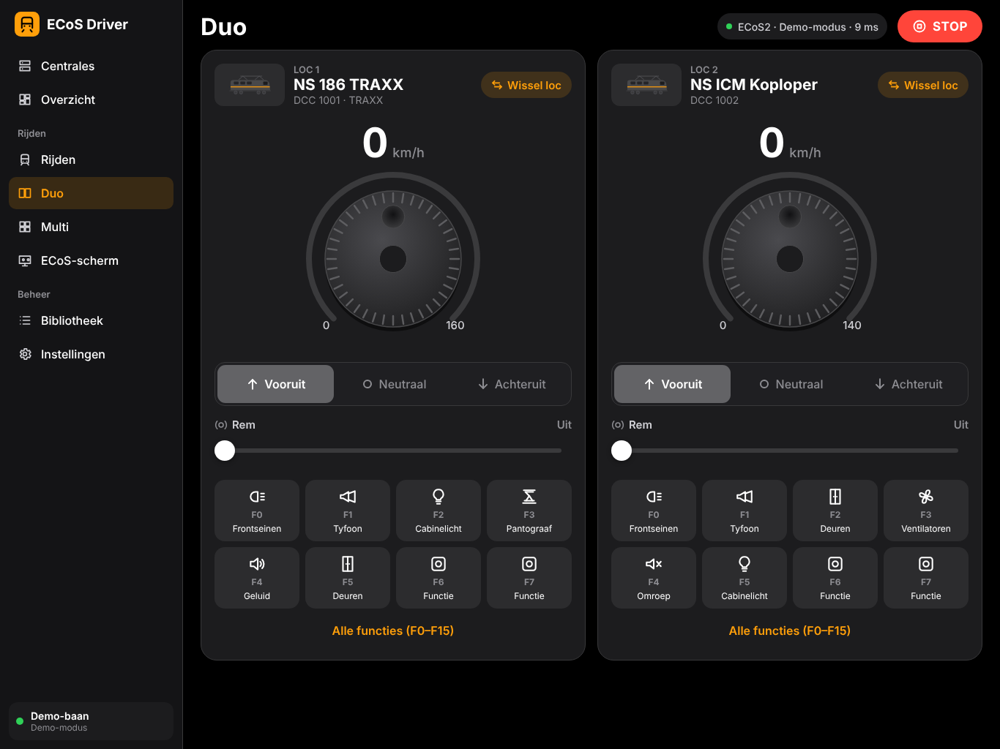 | 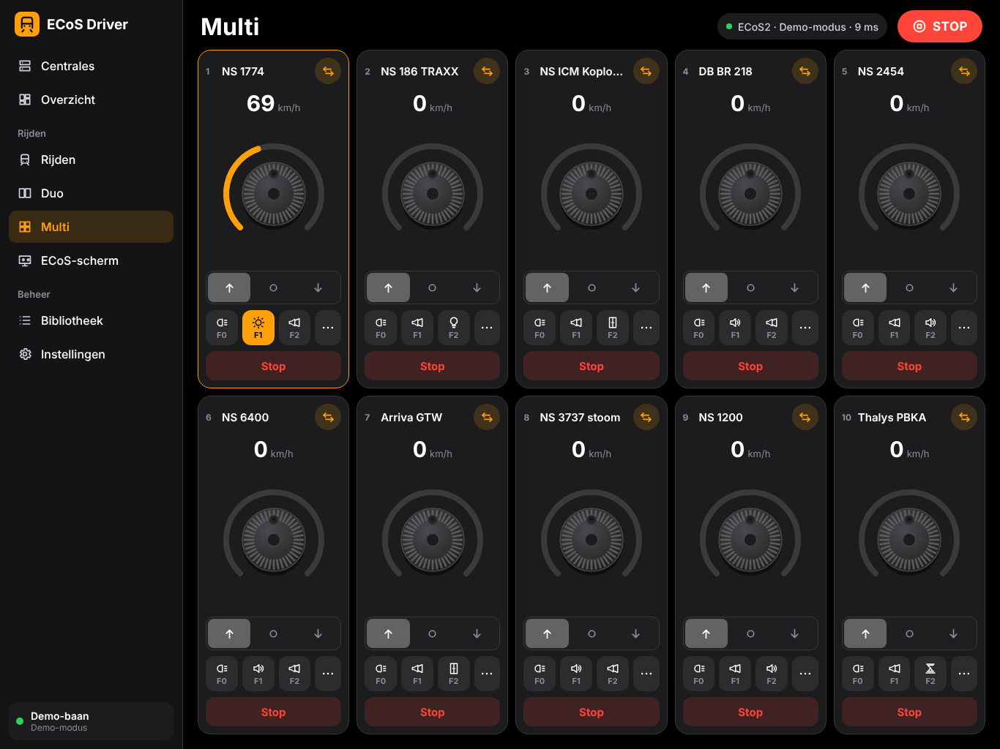 | 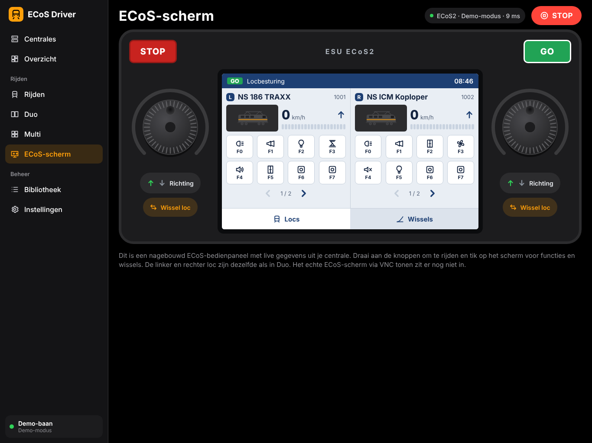 |

| Bibliotheek | Centrales | Rijden (staand) |
| --- | --- | --- |
| 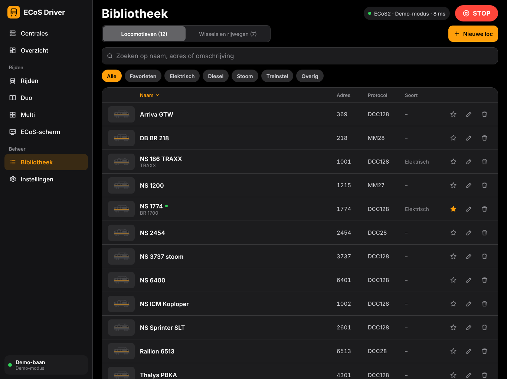 | 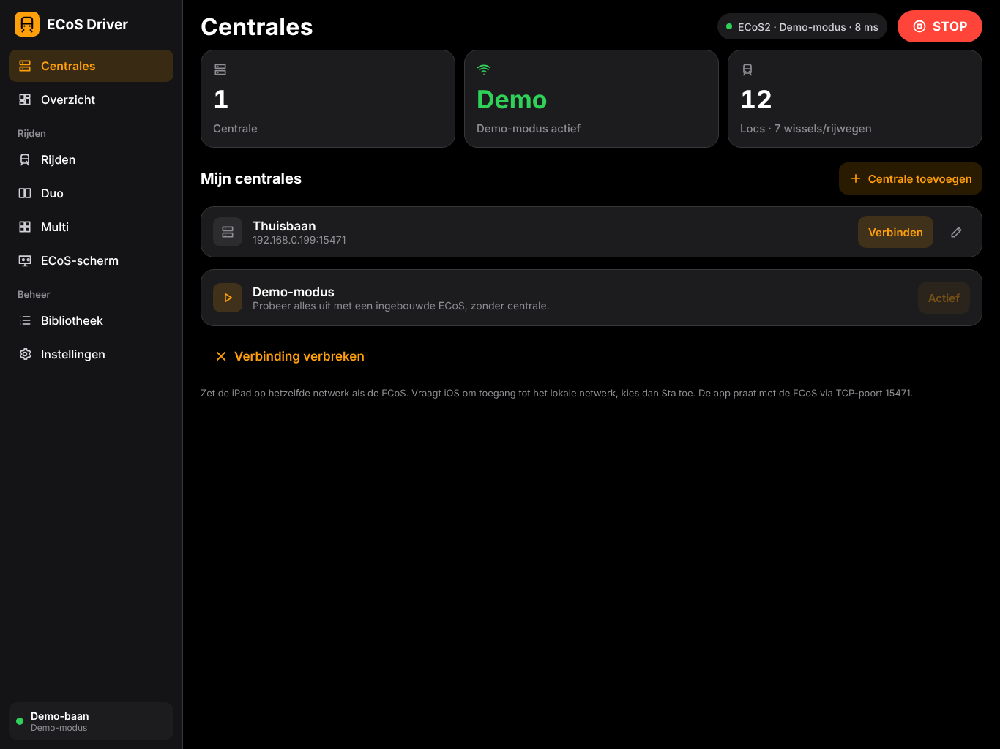 | 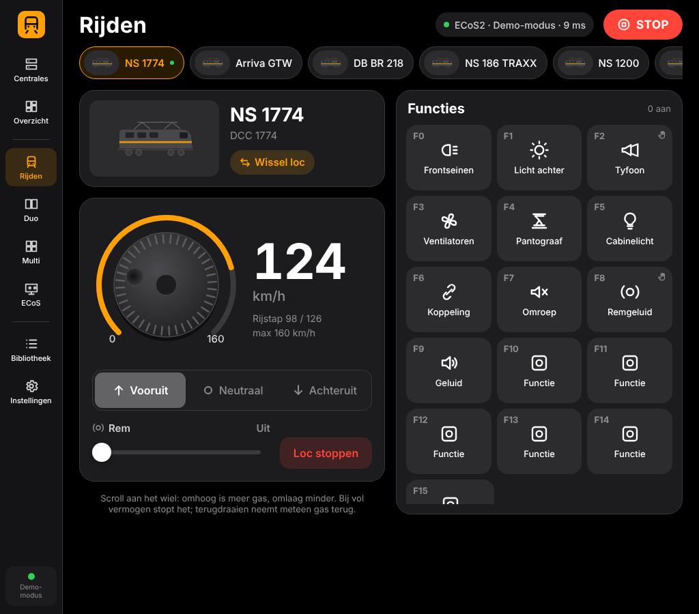 |

| ECoS live (VNC, demo) | Licht thema: Rijden | Licht thema: Duo |
| --- | --- | --- |
| 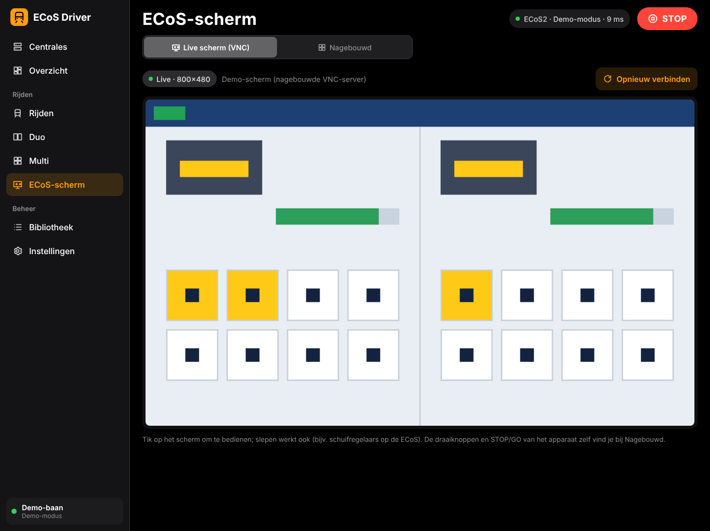 | 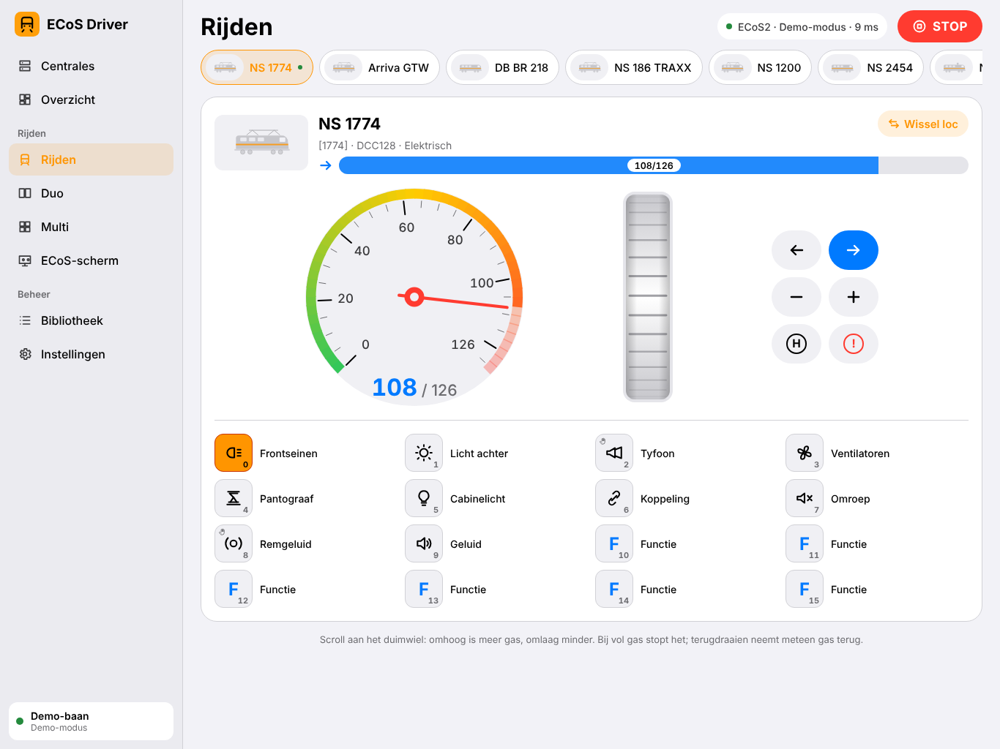 | 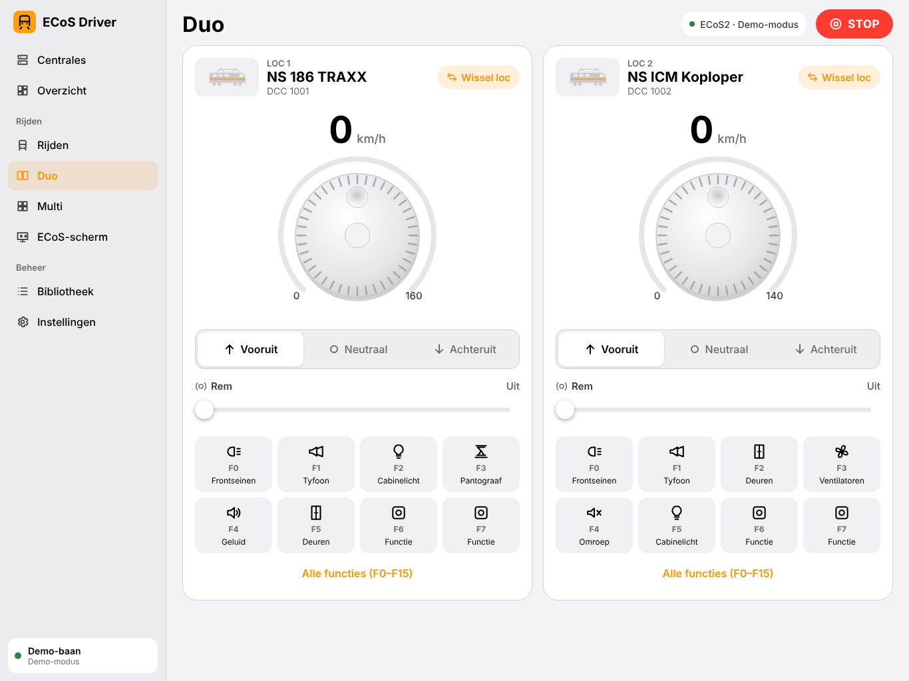 |
